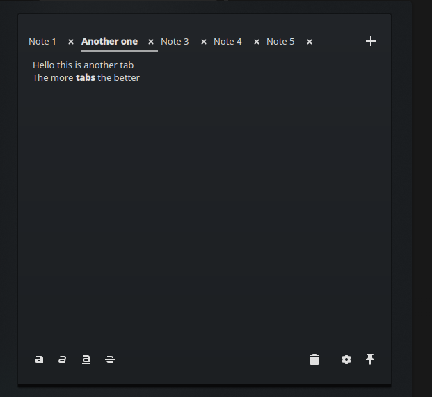

<!-- SPDX-License-Identifier: GPL-2.0-or-later -->

# Plasma Tabbed Notes

A KDE Plasma 6 desktop sticky note widget with support for multiple tabs.



An independent, unofficial fork of KDE Plasma's Sticky Note widget. It keeps
the familiar note appearance, rich-text editor and desktop/panel integration,
with separate notes in a compact tab bar.

## Features

- Create, rename and close tabs; drag titles to reorder them.
- Scroll overflowing tabs, including by holding a dragged tab near an edge.
- Switch with Ctrl+Tab and Ctrl+Shift+Tab.
- Keep independent editing and undo histories for each opened tab.
- Restore notes, tab order and the active tab after restarting Plasma.
- Recover closed notes; retain note files when a widget or the package is removed.

Double-click a title to rename it. Closing a nonempty tab asks for confirmation
inside the widget. Hiding or closing the widget cancels a pending tab closure.
The fork uses its own plugin ID, `dev.kaidoom.tabbednotes`, and does not replace
KDE's original Sticky Note.

## Compatibility

Requires Plasma 6.7+, Qt 6.10+ and KDE Frameworks 6.26+. Tested on Fedora KDE 44
with Plasma 6.7.5, Qt 6.11.2 and Frameworks 6.31.0, using Wayland. Other
distributions and newer Plasma versions have not been verified.

## Build

Install the Fedora build dependencies:

```sh
sudo dnf install git gcc-c++ cmake ninja-build extra-cmake-modules \
  qt6-qtbase-devel qt6-qtdeclarative-devel libplasma-devel \
  kf6-kconfig-devel kf6-kcoreaddons-devel kf6-ki18n-devel \
  kf6-ksvg-devel rpm-build plasma-sdk
git clone https://github.com/Kaidoom/plasma-multi-tab-sticky-notes.git
cd plasma-multi-tab-sticky-notes
cmake -S . -B build -G Ninja -DCMAKE_BUILD_TYPE=RelWithDebInfo \
  -DCMAKE_INSTALL_PREFIX=/usr
cmake --build build
ctest --test-dir build --output-on-failure
```

To preview the build without installing it (`plasmoidviewer` comes from
`plasma-sdk`):

```sh
QT_PLUGIN_PATH="$PWD/build/bin${QT_PLUGIN_PATH:+:$QT_PLUGIN_PATH}" \
  plasmoidviewer -a dev.kaidoom.tabbednotes
```

This is a compiled applet with embedded QML. It cannot be installed as a
QML-only widget using `kpackagetool6`.

## Install, update and uninstall

Build the Fedora RPM from the current Git commit, then install it:

```sh
./tools/build-rpm.sh
sudo dnf install ./dist/plasma-sticky-note-tabs-0.3.1-1.*.rpm
```

The RPM installs into Fedora's standard Qt plugin directory
(`/usr/lib64/qt6/plugins/plasma/applets/` on x86_64). No persistent environment
variables or Plasma service changes are needed. Log out and back in after
installation or an update, then add **Plasma Tabbed Notes** from the widget
chooser. To update, pull the latest source and repeat the build/install steps.

To uninstall:

```sh
sudo dnf remove plasma-sticky-note-tabs
```

## Storage and recovery

Notes are UTF-8 rich-text files in `$XDG_DATA_HOME/plasma_tabbed_notes/`, normally
`~/.local/share/plasma_tabbed_notes/`. KDE's original `plasma_notes` directory is
unaffected. Tab titles, order, active selection and cursor/scroll positions are
stored in the widget's `tabState` entry in Plasma's configuration, normally
`~/.config/plasma-org.kde.plasma.desktop-appletsrc`.

Closing a tab, removing a widget or uninstalling the package retains the note
files. Use **Recover Closed Note…** in the widget's context menu to copy a retained
note into a new tab. To view a retained file elsewhere, copy it to a filename
ending in `.html` and open it in a browser.

Back up both the note directory and Plasma's configuration while Plasma is
stopped. Edits save automatically and before switching tabs; forced termination
can still lose edits that have not yet been saved.

## Attribution and licensing

Derived from [`KDE/kdeplasma-addons`](https://github.com/KDE/kdeplasma-addons),
`applets/notes/`, release **v6.7.5**, commit
[`fa98db42c07adb9f459deecc00a9e0ae0206ab56`](https://github.com/KDE/kdeplasma-addons/commit/fa98db42c07adb9f459deecc00a9e0ae0206ab56).
Thanks to the KDE Sticky Note authors, contributors and translation teams.
This project is not an official KDE product or endorsed by KDE. Report issues
in [this repository](https://github.com/Kaidoom/plasma-multi-tab-sticky-notes/issues).

The applet is distributed under GPL-2.0-or-later, with components under their
own GPL, LGPL and BSD terms. Original copyright and license notices are
preserved. See [LICENSE.md](LICENSE.md) for the file-level overview,
[LICENSES/](LICENSES/) for the license texts, and [UPSTREAM](UPSTREAM) for provenance.
